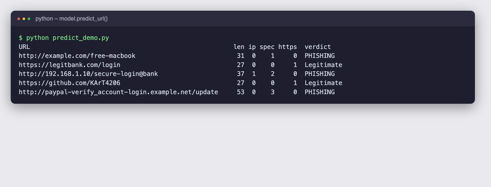

# Phishing Website Detection using Machine Learning

[](LICENSE)


A small machine-learning project that decides whether a URL is **Phishing** or **Legitimate** by looking only at features extracted from the URL string. A Flask web endpoint wraps the trained model so a user can paste a link and get a verdict.

> This repository documents the project (description, design, screenshots). The source code lives in a private repository.

## Screenshot

Real output of the trained model on five URLs, with the four features it sees:



## How it works

```
URL string -> feature extraction -> Random Forest -> 1 = Phishing / 0 = Legitimate -> Flask page
```

1. **Dataset**: `urls.csv` holds labelled URLs (`url,label`; `1` = phishing, `0` = legitimate), e.g. `http://fakebank.com/account-verification` is labelled phishing.
2. **Features** (computed per URL):
   | Feature | Meaning | Why it matters |
   |---|---|---|
   | `url_length` | characters in the URL | phishing URLs tend to be long |
   | `has_ip` | URL contains a dotted IP address | hides the real domain |
   | `special_chars` | count of `-`, `@`, `_` | used to imitate brand names |
   | `https` | scheme is `https` | weak positive signal |
3. **Training**: a scikit-learn `RandomForestClassifier` is fitted on those four columns and saved as `model.pkl`; on later runs it is simply reloaded.
4. **Prediction**: `predict_url(url)` extracts the same features and returns the class.
5. **Web layer**: Flask serves a form (`/`) and a `POST /predict` route that renders "Phishing" or "Legitimate" for the submitted URL.

In the screenshot, `http://paypal-verify_account-login.example.net/update` is long, has three special characters and no HTTPS, so it is flagged; `https://github.com/KArT4206` is short, clean and HTTPS, so it passes.

## Tech stack
Python, pandas, scikit-learn (Random Forest), Flask, pickle.

## Limitations
- The sample dataset is tiny (10 rows), so this is a teaching demo rather than a production detector.
- Only lexical URL features are used; no domain age, TLS, or page content.

## Author
Karthik B. Licensed under GPL-3.0.
